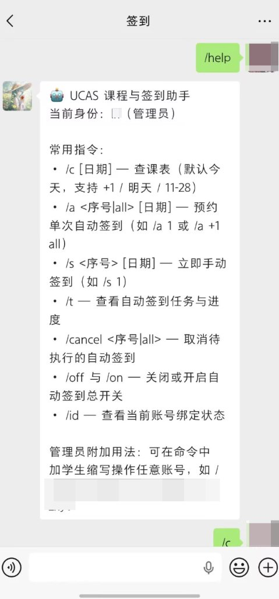

# UCAS-AutoSign-Bot

基于 [lccipher/UCAS-Course-Sign-in](https://github.com/lccipher/UCAS-Course-Sign-in) 修改的自托管版本，平时自己和几个同学查课表、刷签到二维码、手动签到和挂单次定时签到用，也可以直接在个人微信里发 `/` 指令操作。

因为加了会话鉴权、本地 SQLite 任务库和 `systemd` 定时巡检，这个仓库只能跑在**单实例常驻的 Node.js 进程**上（比如一台小 VPS 或 LXC 容器），不能直接丢上 Vercel 这类 Serverless 平台，也不支持多实例横向扩容。

> 请只添加本人或已获对方同意的账号，按学校考勤规定使用。定时任务需要按每节课单独确认，无法保证学校接口每次都放行。

## 相比原版改了什么

- 加了一层网页访问密码。未登录时页面是个充门面的菜谱页，输入口令后才进课表界面；登录态存在服务端内存里（8 小时过期），带简单的 IP 限流和同源校验。
- 账号密码放服务端托管。`config/private.json` 里配好学号和共享密码后，网页端只下发英文缩写（别名），不再从浏览器传密码；临时查别人课表也可以直接手输学号。
- 重写了前端界面，改成浅色报刊排版，手机上点按顺手一些。
- 加了单次定时签到。按具体某天某节课确认预约，任务落在 SQLite 里，关掉网页照样跑。
- 接入了企业微信推送与斜杠指令机器人。配合企业微信后台的「微信插件」，不用装企业微信 App，直接在个人微信里就能发 `/c` 查课表、`/a` 预约自动签到、`/s` 手动签到，并一对一接收签到成功或异常提醒。

## 定时签到怎么跑

每次预约只管**单个账号的当堂课**，不会自动续订下周同一节课。

| 环节 | 当前逻辑 |
| --- | --- |
| 计划时间 | 开课前 **6～10 分钟**内随机取一秒。用「学号 + 日期 + 排课 ID」算固定哈希，反复刷新或重新预览也是同一秒。 |
| 巡检与截止 | `systemd` 每 **10 秒**触发一次检查；最晚截止到**开课前 30 秒**（如果计划时间本身更晚，则卡在开课时间）。 |
| 超时与重试 | 登录和拉课表超时均为 15s，签到请求 10s。遇到课前高峰超时会自动重试，准备阶段最多试 **8 次**（间隔 `15s -> 30s -> 30s...`，临近截止前如果还剩 15s 以上会做最后一次 10s 补试）。 |
| 结果核实 | 请求超时或返回不明确时不会无脑重发，而是先重拉课表确认是否已经签上；已发出但尚未落定的任务不允许取消。 |
| 运行模式 | 默认是 `dry-run`（只走流程不发真实签到请求），环境变量显式设成 `live` 才会真签。 |

### 关于 20 条记录上限

任务列表和 SQLite 数据库**全库合计最多保留 20 条记录**（所有账号、所有状态的任务混在一起按 `updatedAt` 倒序算，不是每人 20 条）。

超出 20 条的旧任务会连同事件日志一起从数据库里删掉。如果排了太多课把还没执行的旧任务挤出前 20 条，被删掉的任务就不会再执行了；如果刚好要删到一条正在提交中的任务，新建操作会报 `TASK_RETENTION_BUSY`，等它提交完再试就行。

## 企业微信推送与指令交互（直达个人微信）

支持自建应用（推荐，能按人一对一收发消息）和群机器人 Webhook。参考 [`config/example.json`](./config/example.json) 里的 `wecom` 字段配置：

```json
"wecom": {
  "enabled": true,
  "corpId": "ww_你的企业ID",
  "agentId": "1000002",
  "corpSecret": "自建应用Secret",
  "adminUserIds": ["admin"],
  "callbackToken": "后台随机生成的Token",
  "callbackEncodingAesKey": "后台随机生成的43位EncodingAESKey",
  "notifyOnSuccess": true,
  "alwaysNotifyAdmin": false,
  "fallbackAdminOnSuccess": false
}
```

接入自建应用的步骤：

1. **配回调 URL 与企业可信 IP**：企业微信要求先配「接收消息服务器 URL」才能填可信 IP。先把后台「API 接收消息」里随机生成的 Token 和 EncodingAESKey 填进 `private.json`，然后在后台 URL 栏填 `https://<你的域名>/api/wecom/callback` 点保存通过验证，最后把服务器出口 IP 加进「企业可信 IP」。
2. **扫码绑定个人微信**：在企业微信管理后台打开「我的企业 -> 微信插件」，把关注二维码发给同学扫一下即可在个人微信收发消息。如果对方手机或电脑上同时登着企业微信客户端，记得关掉客户端里的「仅在企业微信中接收消息」。
3. **填成员 `wecomUserId`**：确保成员在自建应用的可见范围内。新成员如果不清楚自己的企业微信账号，关注后直接在微信里发一条 `/id`，机器人就会回复他的 `wecomUserId`，复制填到 `private.json` 对应学生的字段里即可（无需重启服务）。

推送规则默认是：绑了 `wecomUserId` 的同学，课程签到成功和失败都会一对一收到通知（包含课程名、时间和状态说明）；没绑 `wecomUserId` 的同学平时签成功不打扰管理员，只有失败或异常时才会兜底发给 `adminUserIds`。

命令行也可以直接发测试消息（不打印任何密钥）：

```sh
# 发给管理员通道
node scripts/test-wecom.mjs

# 测试某个学生账号（传 id 或 name 都行）
node scripts/test-wecom.mjs --account zs
```

### 微信里发指令查课与签到

在个人微信的「签到」聊天框里直接发 `/` 开头的消息就能查课、签课或管自动签到（兼容手机中文输入法的全角 `／`）：

| 指令 | 说明与示例 |
| --- | --- |
| `/help` | 查看指令说明与当前绑定身份 |
| `/c [日期]` | 查课表并列出课程序号（默认今天，支持 `/c +1`、`/c 明天`、`/c 11-28`） |
| `/a <序号\|all> [日期]` | 预约单次自动签到（如 `/a 1`、`/a 1,3`、`/a +1 all`；若自动签到开关未开会自动打开） |
| `/s <序号> [日期]` | 立即手动签到（如 `/s 1`；签成功后若该课有待执行的自动预约会一并取消） |
| `/t` | 查看待执行与最近结束的自动签到任务 |
| `/cancel <序号\|all>` | 取消待执行的自动签到任务（如 `/cancel 1`） |
| `/off` / `/on` | 关闭或开启账号的自动签到总开关 |
| `/id` | 查看当前企业微信 `UserID`、绑定缩写与开关状态 |

权限按企业微信账号做了隔离：普通成员只能查和操作自己绑定的学号；`adminUserIds` 里的管理员可以额外加学生缩写操作任意账号（如 `/c zs +1`、`/a zs all +1`、`/s zs 1`、`/t zs`）。

<p align="center">
  
</p>

## 用 Claude Code / Codex 一键部署

如果你在服务器上装了 **Claude Code** 或 **Codex**（或者通过本地 Agent SSH 连上你的 VPS），可以直接把下面这段 Prompt 发给它，让它一步步带你装好网页端、定时调度和企业微信机器人：

````text
请帮我在当前 Linux 服务器上完整部署 https://github.com/Z2U35/UCAS-AutoSign-Bot （包含网页端、systemd 定时自动签到和企业微信个人微信机器人）。请先阅读仓库里的 README.md、doc/deployment.md 和 config/example.json，严格遵守以下流程分步执行：

1. 环境检查与信息收集：
   - 检查系统环境：确保安装 Node.js 24（本项目依赖内置 node:sqlite）、git，并查看当前服务器已有的反向代理（Nginx / OpenResty / Caddy）及服务器公网出口 IPv4。
   - 向我询问确认以下信息后再动手修改配置：
     a) 准备绑定的 HTTPS 域名；
     b) 国科大 iClass 学生登录密码（studentPassword）以及需要添加的学生列表（英文缩写 name + 15 位学号 studentId）；
     c) 是否启用企业微信机器人（若启用，请引导我去企业微信后台创建自建应用，提供 corpId、agentId 和 corpSecret）。
   - 安全要求：严禁将密码或密钥提交到 Git，config/private.json 权限必须保持 0600。

2. 部署服务与定时调度：
   - 按 doc/deployment.md 拉取仓库、安装依赖（npm ci）并完成生产构建（npm run build）。
   - 运行 scripts/setup-access.mjs 生成网页访问密码（提醒我保存 config/access-password.txt 中的口令后将该文件删除），并写入 config/private.json。
   - 运行 scripts/setup-auto-sign.mjs 生成机器密钥，配置 /etc/ucas-signin/auto-sign.env（初始先设为 dry-run），安装并启动 ucas-signin.service（仅监听 127.0.0.1）和 ucas-auto-sign.timer。
   - 配置 HTTPS 反向代理指向本机监听端口，确保公网 HTTPS 访问正常。

3. 引导打通企业微信与个人微信「/」指令机器人：
   - 引导我在企业微信后台「应用管理 -> 自建应用 -> API 接收消息」中点击随机生成 Token 和 EncodingAESKey 发给你写入 config/private.json。
   - 让我填好回调地址 https://<我的域名>/api/wecom/callback 保存通过验证后，再把你查到的服务器出口 IP 填入「企业可信 IP」。
   - 引导我在「我的企业 -> 微信插件」扫码关注后，直接在个人微信「签到」对话框发送 /id 获取我的企业微信 UserID，帮我填入 private.json 的 adminUserIds 和对应学生的 wecomUserId。
   - 运行 node scripts/test-wecom.mjs 验证个人微信能收到测试推送，并在微信里实测 /help 和 /c 正常回复后，将 UCAS_AUTO_SIGN_MODE 切换为 live 并重启服务。
````

## 本地跑起来

需要 **Node.js 24**（直接用了内置的 `node:sqlite`，不用额外装 SQLite 驱动或数据库服务）。

```sh
git clone https://github.com/Z2U35/UCAS-AutoSign-Bot.git
cd UCAS-AutoSign-Bot
npm ci
```

初始化本地配置文件（`--local-http` 仅限本机 `127.0.0.1` 或 SSH 转发调试用，线上走 HTTPS 时不要加这个参数）：

```sh
node scripts/setup-access.mjs --local-http
```

跑完会生成 `config/private.json` 和存着随机初始口令的 `config/access-password.txt`（终端里不打印密码）。把口令记好后删掉 `access-password.txt`，再参照 [`config/example.json`](./config/example.json) 填好 `config/private.json`：

- `access`：保留脚本生成的哈希和密钥别动；以后想换访问口令可以跑 `node scripts/setup-access.mjs --rotate`。
- `studentPassword`：iClass 系统的学生登录密码（和网页访问口令不是一回事），没填之前页面打不开。
- `students`：配快捷账号。`id` 保持唯一，`name` 用字母开头的简短英文别名，`studentId` 是 15 位数字字符串。

改完保存就能启动开发服：

```sh
npm run dev -- --hostname 127.0.0.1
```

浏览器打开 `http://127.0.0.1:3000`。平时往 `config/private.json` 里增删学生或改推送配置，保存后刷新网页就生效，不用重新构建或重启服务。本地只起网页不会装定时器，也不会触发真实自动签到。

## 服务器部署

完整的 systemd 单元配置、目录权限和上线步骤写在 [`doc/deployment.md`](./doc/deployment.md) 里，这里只列几条容易踩坑的地方：

- 服务只监听 `127.0.0.1`，外面套一层 Nginx / OpenResty 反代并强制 HTTPS，初始化配置时不要带 `--local-http`。
- 定时调度的内部接口靠机器密钥鉴权，用 `node scripts/setup-auto-sign.mjs --key-file /var/lib/ucas-signin/auto-sign.key --create-directory` 生成（目录权限要求 `0700`）。
- 刚搭好时先在 `dry-run` 下跑一两节课看日志没问题，再把 `ucas-auto-sign.service` 切到 `live`。
- 线上更新代码时别直接在运行目录里 `npm run build` 覆盖 `.next`，先在同盘的临时目录构建跑通测试，再替换 `.next` 并重启服务。

## 测试与目录说明

下面这些检查全部跑本地逻辑或 Mock 上游，不会碰真实学校接口，也不会连线上数据库：

```sh
npm run lint
npm run test:auto-sign
node --test scripts/test-student-id-memory.mjs
npm run build
node scripts/test-access.mjs   # 依赖上一步的构建产物，会自动起独立端口做集成测试
```

主要代码位置：

```text
config/example.json            私有配置模板（真实配置写在 config/private.json，已被 Git 忽略）
doc/
  deployment.md                服务器部署、systemd 与 HTTPS 反代指南
  img/wecom-bot.jpg            个人微信斜杠指令交互截图
scripts/
  setup-access.mjs             生成/轮换网页访问密码与会话密钥
  setup-auto-sign.mjs          生成定时调度用的机器密钥
  trigger-auto-sign.mjs        systemd timer 调用的巡检触发脚本
  test-wecom.mjs               企业微信推送命令行测试工具
  ucas-*.service / .timer      systemd 服务与定时器模板
src/
  app/components/              前端页面组件（入口页、课表、二维码、定时任务面板）
  app/api/access/              登录、登出与公开账号列表接口
  app/api/course-uuid/         查课表、对时、手动签到接口
  app/api/auto-sign/           定时任务创建、预览、取消与账号开关接口
  app/api/internal/auto-sign/  仅供本机 timer 调用的巡检接口
  app/api/wecom/callback/      企业微信回调验证与加密指令消息入口
  lib/iclass.ts                上游 iClass 登录、课表与签到请求封装
  lib/private-config.ts        private.json 读取与字段校验
  lib/auto-sign/               定时调度、企微消息加解密推送与斜杠指令机器人
```

## 致谢与许可证

上游原仓库为 [lccipher/UCAS-Course-Sign-in](https://github.com/lccipher/UCAS-Course-Sign-in)，感谢原作者打通的课程查询与签到流程；当前分支由 [@Z2U35](https://github.com/Z2U35) 维护。

本项目沿用上游的 [GNU AGPL-3.0](./LICENSE) 许可证。
